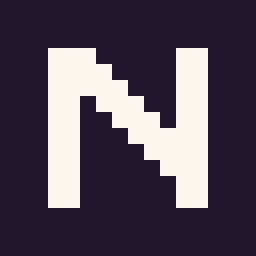

<div align="center">

<a href="https://sliiu.github.io/nook/"></a>

<br>

# Nook

### 菜单栏里的一间像素小房间。

**横向拖动调音量，纵向拖动调亮度。**<br>
界面是一个 HTML 场景，场景就是你自己的控制中心。

[](https://github.com/sliiu/nook/releases/latest) [](LICENSE)<br>


**[下载](https://sliiu.github.io/nook/)** &nbsp;·&nbsp; **[场景](https://github.com/sliiu/nook-scenes)** &nbsp;·&nbsp; **简体中文** · [English](README.md)

</div>

<br>

## 安装

从 [Releases](https://github.com/sliiu/nook/releases) 下载最新的 `.dmg`，拖入「应用程序」。应用未签名、未公证，首次打开请右键 → 打开。

> 仅在 **Apple Silicon（arm64）+ macOS 26.6.2** 上测试过。其他芯片和系统版本未经验证，遇到问题欢迎提 issue。

## 场景

场景就是你自己的控制中心：单个 HTML 文件，使用全局的 `Control` 和 `events`。浮层的尺寸、圆角和背景都由场景决定，所以样子和放哪些控制项由你来定。

音量和亮度是头两项。麦克风、输出设备和媒体键会接着加，场景届时用同一个 `Control` 就能用到。

- **Home** 是随应用附带的示例，一个二维点控，横向音量，纵向亮度。可以编辑，不能删除；「还原出厂 Home」会写回内建版本。
- **导入**只载入预览，按下保存才会写入。
- **市场**场景来自清单仓库 [`sliiu/nook-scenes`](https://github.com/sliiu/nook-scenes)，合并后才上架。安装时核对哈希，并在沙箱里运行，只能调节音量和亮度。入口是 `nook://scene/<id>`。

让 agent 来安装应用、设计场景并提交，安装 [`nook-scene`](skills/nook-scene/SKILL.md) 技能：

```bash
npx skills add sliiu/nook@nook-scene
```

## 开发

需要 Go 1.27.3+，macOS 上构建需 `CGO_ENABLED=1`。

```bash
go mod tidy
CGO_ENABLED=1 go build -o pixel-control-center .
CGO_ENABLED=1 go run github.com/egoist/mygo/cmd/mygo build   # 产出 dist 下的 .app 与 .dmg
```

## 信任与风险

- 自己写的和从文件导入的场景与应用权限相同，只导入信任的文件。
- 亮度只支持内建屏，走 macOS 私有接口，系统升级可能失效。没有内建屏时，纵轴仅作预览。

## 灵感致谢

像素房间与透镜改编自 [slider-resident](https://ludion.ai/p/slider-resident)（MIT，@Lattice_Node）。出厂场景为原创，不整文件复用。

## 支持

如果 Nook 对你有帮助，欢迎请我喝杯咖啡：

<a href="https://www.buymeacoffee.com/pax_z" target="_blank"></a>
